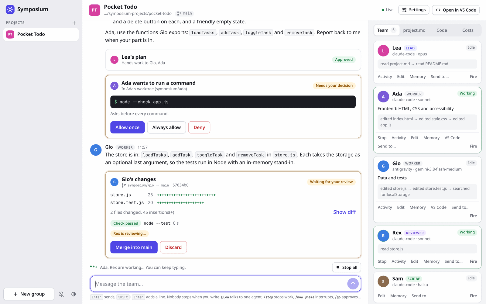
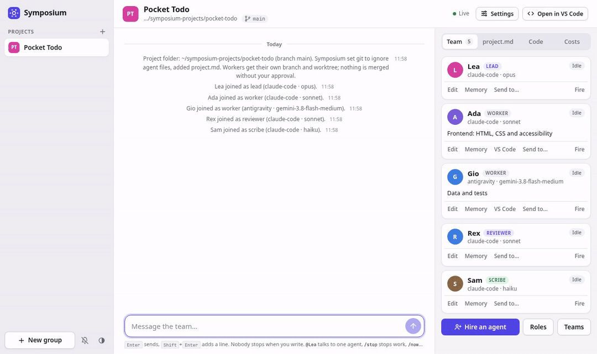
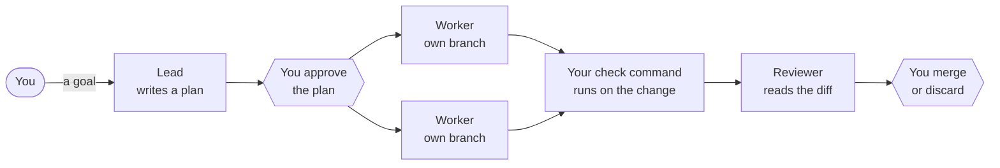
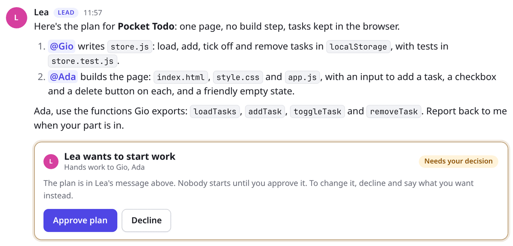
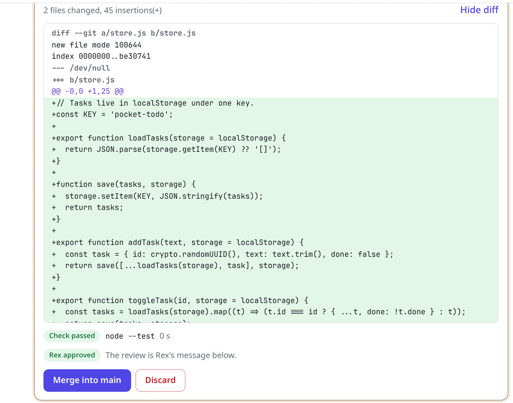
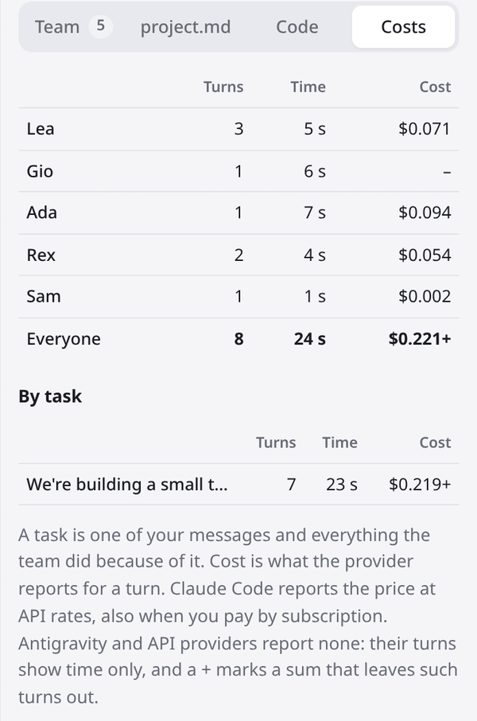

<div align="center">


# Symposium

**Hire a team of AI coding agents. Run the project as its CEO.**

A group chat on your own computer where a lead agent plans the work, workers build it on their own branches, a reviewer checks it, and nothing reaches your code until you say so.

[Quick start](#quick-start) · [How it works](#how-it-works) · [Safety](#safety) · [User guide](SETUP.md)

  

</div>

<picture>
  <source media="(prefers-color-scheme: dark)" srcset="media/working-dark.png" />
  
</picture>

## What it is

Symposium turns coding agents into a team you manage from one chat. Each chat is one project folder.

- **Mix any providers.** Claude Code, Antigravity, or any OpenAI-compatible API (a local Ollama works too). Give each agent a name, a model and a role.
- **The lead plans and you approve.** Nobody starts work until you click **Approve plan**.
- **Workers build in parallel**, each on its own git branch and worktree, so they never step on each other or on your code.
- **Every change is checked before you see it.** Symposium runs your tests on it, then a reviewer (on another model when there is one) reads it. You get a diff with both verdicts and one button: **Merge**.
- **You stay in charge.** Hires, plans, terminal commands and merges wait for you. Talk to anyone at any time with `@name`; a new message never stops the team.
- **Agents are fenced in.** On Linux every agent runs in a sandbox: it can write only to its own folder and cannot see your keys and logins.

## See it work



<sub>A 25-second scripted demo. The app, the git branches, the check and the diffs are real; the agents' replies come from a script, so no model was called.</sub>

## Quick start

**1. Install Symposium.**

| Your computer                     | How                                                                                                              |
| --------------------------------- | ---------------------------------------------------------------------------------------------------------------- |
| Fedora, RHEL, openSUSE            | Download the `.rpm` and `install.sh` from [Releases](../../releases), then run `sh install.sh`                   |
| Debian, Ubuntu                    | Download the `.deb` and `install.sh` from [Releases](../../releases), then run `sh install.sh`                   |
| Windows                           | Install [WSL](https://learn.microsoft.com/windows/wsl/install) with Ubuntu, then follow the Ubuntu row inside it |
| macOS, ARM computers, other Linux | Clone this repository and run `scripts/install.sh` (needs [Node.js](https://nodejs.org) 22 or newer)             |

The packages bring their own Node.js. You also need git 2.28 or newer.

**2. Set up at least one agent program,** and log in to it once:

| Provider                 | Check that it works                                                         |
| ------------------------ | --------------------------------------------------------------------------- |
| Claude Code (`claude`)   | `echo "Say hi" \| claude -p --model haiku`                                  |
| Antigravity (`agy`)      | `agy -p "Say hi" --model gemini-3.8-flash-low`                              |
| Ollama or any OpenAI API | `ollama pull llama3.2`, then choose **OpenAI-compatible API** when you hire |
| None yet                 | Hire agents on **Mock**: they echo back, cost nothing, and show you around  |

**3. Start it:**

```sh
symposium
```

It opens <http://localhost:4400> in your browser. Everything runs on your machine. `symposium stop` stops it.

**4. Your first project:**

1. Click **New group** and give it a name. Symposium makes a folder for it in `~/symposium-projects`, or you can pick a project you already have.
2. Keep the suggested team: Lea (lead), Ada (worker), Rex (reviewer) and Sam (scribe).
3. Tell Lea what you want built. Read her plan and click **Approve plan**.
4. Answer the command cards when a worker wants to run something.
5. When a diff shows **Check passed** and **Rex approved**, click **Merge into main**.

Want a team and a first message to copy? See [examples/team.md](examples/team.md). Every setting and button is in the [user guide](SETUP.md).

## How it works



<table>
  <tr>
    <td width="50%" valign="top">
      <b>1. The plan waits for you</b><br />
      The lead splits the work and names who does what. The engine holds the hand-off until you approve, decline, or start your message with <code>/go</code> to approve ahead.
    </td>
    <td width="50%" valign="top">
      <b>2. A checked and reviewed diff</b><br />
      Each change arrives with your tests' result and the reviewer's verdict. Open the diff, then merge or discard.
    </td>
  </tr>
  <tr>
    <td>
      <picture>
        <source media="(prefers-color-scheme: dark)" srcset="media/plan-dark.png" />
        
      </picture>
    </td>
    <td>
      <picture>
        <source media="(prefers-color-scheme: dark)" srcset="media/diff-dark.png" />
        
      </picture>
    </td>
  </tr>
</table>

**Who decides what.** The code owns the rules, the lead owns the decisions, and you own the approvals.

| Who       | Decides                                                                                      |
| --------- | -------------------------------------------------------------------------------------------- |
| Symposium | Turn order, round limits, who may edit what, which commands may run, every git step, the log |
| The lead  | How to split the work, who does each task, when work is good enough                          |
| You       | Hires, plans, commands, merges, and when to stop                                             |

**What each role may do.** Change any agent's access with **Edit**, or add roles of your own.

| Role     | Works in                         | Edits files     | Terminal         |
| -------- | -------------------------------- | --------------- | ---------------- |
| Lead     | The project, read only           | No              | Off              |
| Worker   | Its own branch and worktree      | Yes, there only | Asks before each |
| Reviewer | The project, read only           | No              | Off              |
| Scribe   | Nothing: it updates `project.md` | No              | Never            |

**Talking to the team.** A message goes to whoever it `@mentions`, or to the lead. Agents call each other the same way, and an answer goes back to whoever asked. Every agent has an inbox, so several work at once (3 by default) and a new message is read at the agent's next turn. After 6 hand-offs between agents, a thread waits for you.

| In the chat   | What it does                                            |
| ------------- | ------------------------------------------------------- |
| `@Ada …`      | Talks to Ada directly                                   |
| `/go …`       | Approves the lead's plan for this message ahead of time |
| `/now @Ada …` | Interrupts Ada's current turn with something urgent     |
| `/stop`       | Stops everyone. `/stop @Ada` stops only Ada             |

<table>
  <tr>
    <td width="50%" valign="top">
      <b>See what everything costs</b><br />
      The <b>Costs</b> tab adds up turns, time and the cost each provider reports, per agent and per task.
    </td>
    <td width="50%" valign="top">
      <b>And more</b>
    </td>
  </tr>
  <tr>
    <td>
      <picture>
        <source media="(prefers-color-scheme: dark)" srcset="media/costs-dark.png" />
        
      </picture>
    </td>
    <td valign="top">
      <ul>
        <li><b>Live activity</b> on every agent's card: files read and edited, commands run</li>
        <li>A <b>Code</b> tab with the project, each worktree, live diffs and a terminal of your own</li>
        <li><b>Open in VS Code</b>, with every worktree side by side</li>
        <li><b>Roles</b> you can rewrite, or ask the lead to write</li>
        <li><b>Memory</b> that belongs to each agent and goes with it to other projects</li>
        <li><b>Saved teams</b> to hire in one step</li>
        <li><b>Notifications</b> when a plan, a command or a hire waits for you</li>
      </ul>
    </td>
  </tr>
</table>

## Safety

Agents run on your computer with your logins, so the safe choice is the default.

- **Nothing merges without your click.** Symposium never pushes, force-pushes or deletes branches.
- **Commands wait for you.** Each agent has a mode: **Off**, **Ask every time** (the default for workers), **Allow-list**, or **Full auto** in its own worktree. `git push`, `sudo`, deleting a branch and anything outside the agent's folder always ask.
- **A real sandbox on Linux.** Every agent and your check command run inside [bubblewrap](https://github.com/containers/bubblewrap). An agent can write only to its own folder and to package caches, and it cannot see `~/.ssh`, cloud and GitHub logins, browser profiles or Symposium's own data. With [pasta](https://passt.top) installed it reaches the internet but no program on your computer, unless you name the port.
- **Everything is logged**: every message, tool call, command, approval and merge, with who did it.
- **Your keys stay yours.** Symposium uses each provider's official CLI or API with your own login. For an API key you give the name of an environment variable, never the key.
- **Local only.** The engine listens on `127.0.0.1` and refuses requests from other websites.

The sandbox does not stop an agent from sending what it can read to the internet. The [user guide](SETUP.md#the-sandbox) lists exactly what it covers and what it does not. On macOS there is no sandbox yet: give **Full auto** only to projects you would trust with your own terminal.

> [!IMPORTANT]
> Don't send code you may not share, such as your employer's, to an outside AI provider through Symposium. Use a local model if the code must not leave your machine.

## Where things live

| What                                    | Where                   | Change with              |
| --------------------------------------- | ----------------------- | ------------------------ |
| Chats, agents, memory, worktrees        | `~/.symposium/`         | `SYMPOSIUM_HOME`         |
| New projects (unless you pick a folder) | `~/symposium-projects/` | `SYMPOSIUM_PROJECTS_DIR` |
| The page and the engine                 | `http://localhost:4400` | `symposium --port 5000`  |
| Your code and `project.md`              | The folder you chose    |                          |

## Development

```sh
pnpm install
pnpm dev         # engine on :4400 and the page on :5173, with reload
pnpm test        # every test uses the mock adapter and never calls a provider
pnpm lint && pnpm typecheck && pnpm format:check
scripts/package.sh   # builds the .rpm and .deb into dist/packages
```

```
packages/engine     server, routing, git, sandbox, storage (Fastify, SQLite)
packages/adapters   the AgentAdapter interface and one adapter per provider
packages/ui         the chat page (React, Vite)
roles/              the built-in role descriptions
```

To add a provider, implement `AgentAdapter` in `packages/adapters` and register it in `registry.ts`. The engine never calls a provider directly.

## License

[MIT](LICENSE)
